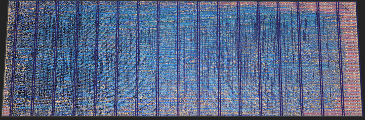

# riscv-vlsi

Diseño, verificación e implementación de microcontroladores RISC-V y flujos de diseño digital, en la Universidad Nacional de Colombia.

El punto de partida es **femto_UN**, un microcontrolador basado en el núcleo RISC-V [FemtoRV32 Quark](https://github.com/BrunoLevy/learn-fpga) (RV32I) de Bruno Levy, diseñado por el profesor Carlos Iván Camargo Bareño y **fabricado** en el shuttle **TTSKY25b** de [Tiny Tapeout](https://tinytapeout.com/chips/ttsky25b/) sobre el proceso SkyWater 130 nm. El procesador lee su programa desde una memoria flash SPI externa, usa una RAM SPI externa y se comunica por UART.



## Resultados

- **Diseño fabricado:** diagrama del RTL, vistas 2D y 3D del layout y métricas de implementación → [`asic/femto_UN_ttsky25b/`](asic/femto_UN_ttsky25b/)
- **El chip funciona en hardware:** arranque con flash emulada, `Hello World from femto UN` por UART y lectura, escritura y persistencia en una RAM FM25V02 → [`pruebas/chip_femto_UN/`](pruebas/chip_femto_UN/)
- **Informe técnico de las pruebas** → [PDF](informes/pruebas_femto_UN/informe_pruebas_femto_UN.pdf) · [fuentes](informes/pruebas_femto_UN/)

## Estado por objetivo

| Objetivo | Issue | Dónde | Estado |
|---|---|---|---|
| OE1. Entorno de verificación open-source | [#9](https://github.com/Femto-UN/riscv-vlsi/issues/9) | [`disenos/vlsi/`](disenos/vlsi/) | Simulaciones con Icarus Verilog y cocotb existentes; falta documentarlas y recopilar sus resultados |
| OE2. Microcontrolador RISC-V con periféricos | [#10](https://github.com/Femto-UN/riscv-vlsi/issues/10) | [`disenos/`](disenos/) | RTL fabricado documentado; falta el documento de arquitectura, subir las mejoras (bus SPI compartido e interrupciones) y los reportes de síntesis |
| OE3. Documentación y material educativo | [#11](https://github.com/Femto-UN/riscv-vlsi/issues/11) | [`informes/`](informes/) | Informe de pruebas publicado ([PDF](informes/pruebas_femto_UN/informe_pruebas_femto_UN.pdf)); falta el inventario del material educativo |
| OE4. Implementación y validación en FPGA | [#12](https://github.com/Femto-UN/riscv-vlsi/issues/12) | — | Pendiente de subir el flujo y las pruebas en la Tang Primer 20K |
| OE5. Fabricación con Tiny Tapeout | [#13](https://github.com/Femto-UN/riscv-vlsi/issues/13) | [`asic/`](asic/), [`pruebas/`](pruebas/) | Diseño fabricado y pruebas del chip documentados; falta el reporte de DRC/LVS |
| OE6. Revisión del área de electrónica digital | [#14](https://github.com/Femto-UN/riscv-vlsi/issues/14) | — | A cargo del equipo docente |

El avance detallado de cada objetivo y sus actividades está en el Project [RISC-V Desarrollo y Seguimiento](https://github.com/orgs/Femto-UN/projects/2).

## Estructura del repositorio

```
riscv-vlsi/
├── disenos/                  Código RTL de los procesadores
│   ├── femto_UN_fabricado/   Diseño enviado a fabricación (referencia, no se modifica)
│   └── vlsi/                 Base para las mejoras del procesador
├── asic/                     Fabricación con Tiny Tapeout
│   └── femto_UN_ttsky25b/    Layout, vistas 3D, RTL y métricas del diseño fabricado
├── pruebas/                  Pruebas en hardware real
│   └── chip_femto_UN/        Fotos, capturas y sesiones de PulseView
├── informes/                 Documentos técnicos
└── docs/                     Guía de colaboración del equipo
```

| Carpeta | Contenido |
|---|---|
| [`disenos/`](disenos/) | Código RTL: el diseño fabricado y la base para las mejoras |
| [`asic/`](asic/) | Fabricación con Tiny Tapeout |
| [`pruebas/`](pruebas/) | Pruebas en hardware real |
| [`informes/`](informes/) | Informes técnicos |
| [`docs/`](docs/) | Guía de colaboración |

## Cómo colaborar

El trabajo se organiza con el flujo **Issue → Rama → Pull Request → Revisión → Integración en `main`**, descrito en la [guía de colaboración](docs/flujo_colaboracion.md). Cada actividad es un sub-issue de su objetivo en el [Project](https://github.com/orgs/Femto-UN/projects/2).

## Créditos

- Diseño original del femto_UN: Carlos Iván Camargo Bareño ([cicamargoba/femto_UN](https://github.com/cicamargoba/femto_UN), [cicamargoba/VLSI](https://github.com/cicamargoba/VLSI)).
- Núcleo FemtoRV32: Bruno Levy ([learn-fpga](https://github.com/BrunoLevy/learn-fpga)).
- Fabricación: [Tiny Tapeout](https://tinytapeout.com).
