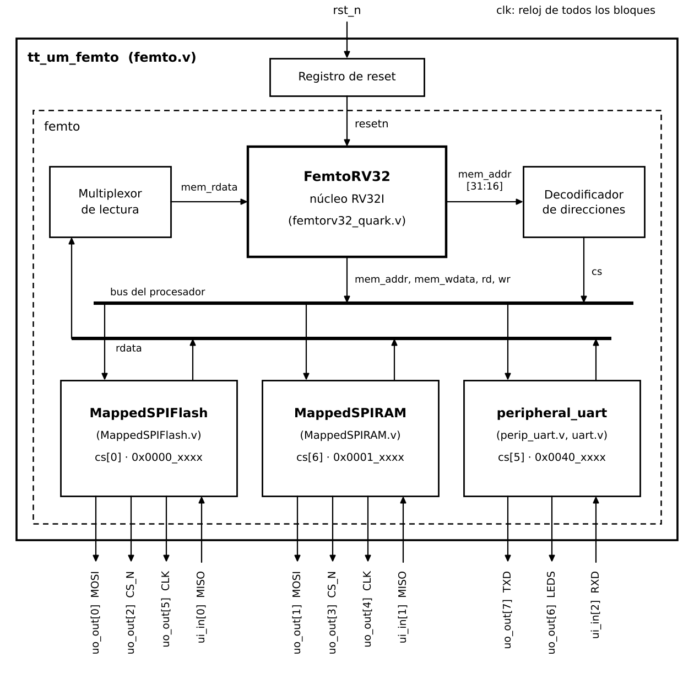
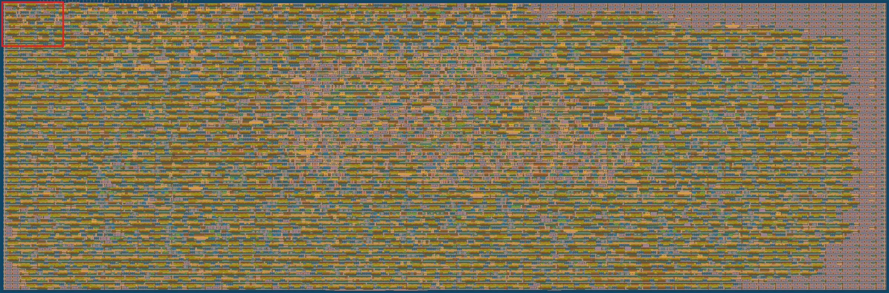
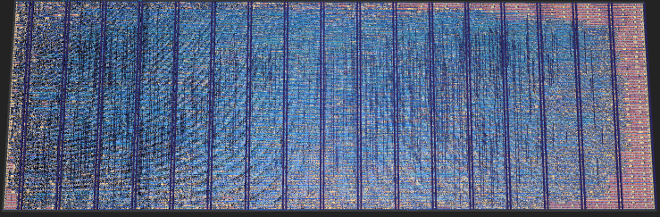
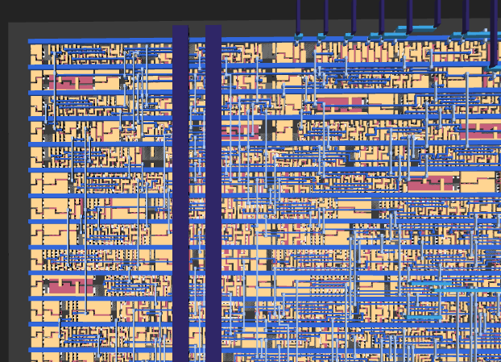
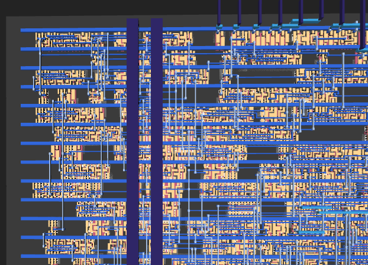
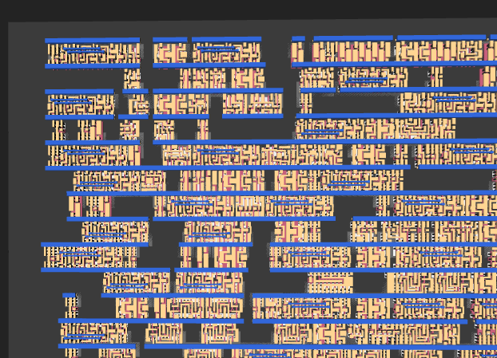
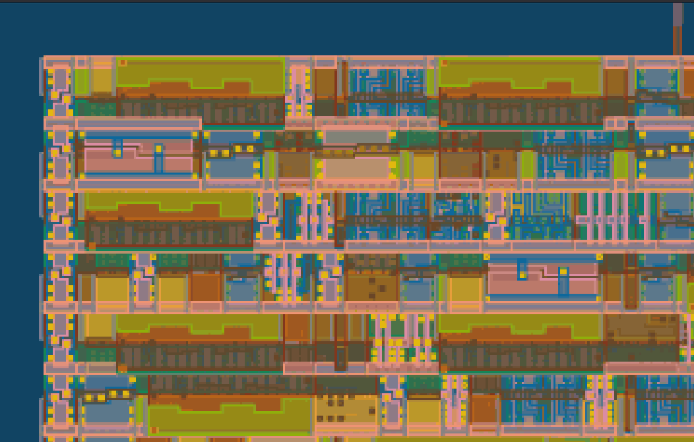
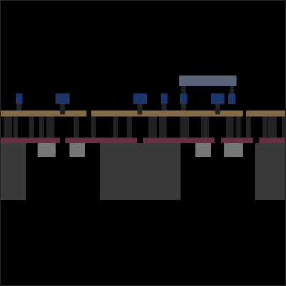
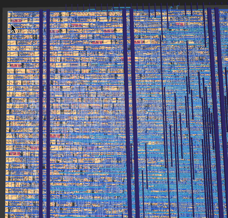

# Diseño fabricado: femto_UN en Tiny Tapeout (TTSKY25b)

Vistas del layout final y resultados de implementación del procesador **femto_UN** (`tt_um_femto`, "UNAL's RISCV"), enviado a fabricación en el shuttle **TTSKY25b** de Tiny Tapeout sobre el proceso **SkyWater 130 nm**.

El layout se tomó del repositorio oficial del shuttle, [`projects/tt_um_femto/tt_um_femto.oas`](https://github.com/TinyTapeout/tinytapeout-sky-25b/tree/main/projects/tt_um_femto), y las vistas 3D se obtuvieron con el visor 3D de Tiny Tapeout.

## Datos del diseño

| Dato | Valor |
|---|---|
| Proyecto | UNAL's RISCV (`tt_um_femto`) |
| Shuttle | TTSKY25b (Tiny Tapeout) |
| Proceso / PDK | SkyWater 130 nm, `sky130A` (open_pdks `0fe599b`) |
| Librería de celdas | `sky130_fd_sc_hd` |
| Flujo | LibreLane 2.4.2 |
| Commit fabricado | [`baab83f`](https://github.com/cicamargoba/femto_UN/commit/baab83f5b7fe16083744b88fc54fe699873517e1) de `cicamargoba/femto_UN` (5 nov 2025) |
| Tamaño | 4×2 tiles: **682,64 × 225,76 µm** (154 113 µm²) |
| Restricción de reloj | 25 ns (40 MHz) |

## Arquitectura RTL

Diagrama de bloques del Verilog fabricado (`femto.v`). Los seis archivos que lista `info.yaml` en el commit `baab83f` son idénticos a los que usó el flujo GDS de Tiny Tapeout.

| Archivo | Líneas | Contenido |
|---|---:|---|
| `femto.v` | 190 | Módulo superior `tt_um_femto` y SoC `femto`: decodificador de direcciones, multiplexor de lectura y asignación de pines |
| `femtorv32_quark.v` | 544 | Núcleo RISC-V FemtoRV32 Quark (RV32I) |
| `MappedSPIFlash.v` | 137 | Controlador de la flash SPI, direcciones `0x0000_xxxx` |
| `MappedSPIRAM.v` | 165 | Controlador de la RAM SPI, direcciones `0x0001_xxxx` |
| `perip_uart.v` | 74 | Periférico de la UART, direcciones `0x0040_xxxx` |
| `uart.v` | 162 | Transmisor y receptor UART |

## Vista general

Render 2D del layout completo generado por Tiny Tapeout. El recuadro rojo marca, de forma aproximada, la zona ampliada más abajo.

Vista 3D del layout completo. Las bandas verticales oscuras corresponden al power grid en metal 4.

## Ampliación de la esquina superior izquierda

Cada fila de celdas de `sky130_fd_sc_hd` mide 2,72 µm de alto, por lo que la zona mostrada tiene cerca de 33 µm de alto.

| (a) Todas las capas | (b) Sin celdas de relleno ni de desacople |
|---|---|
|  |  |
| **(c) Solo celdas estándar** | **(d) Render 2D** |
|  |  |

- **(a)** Rieles de alimentación en metal 1 (franjas horizontales), power grid en metal 4 (bandas verticales) y ruteo de señales.
- **(b)** Al ocultar las celdas de relleno y de desacople aparecen huecos sin lógica; la densidad de colocación objetivo fue del 70 %.
- **(c)** Solo las celdas estándar, alineadas en filas.
- **(d)** Vista plana con los colores de capa de sky130.

## Corte lateral y vista oblicua

| Corte lateral de una sección aislada | Vista oblicua del diseño completo |
|---|---|
|  |  |

## Resultados de implementación

Valores de `stats/metrics.csv` del repositorio del shuttle.

| Métrica | Valor |
|---|---|
| Utilización del área | 76,0 % |
| Área de celdas estándar | 113 440 µm² |
| Celdas secuenciales (flip-flops) | 1 515 |
| Celdas combinacionales de varias entradas | 5 758 |
| Buffers e inversores del árbol de reloj | 80 + 1 296 |
| Buffers de reparación de tiempos | 2 259 |
| Celdas de relleno / tap | 7 159 / 2 158 |
| Diodos de antena insertados | 122 |
| Errores de DRC de ruteo (final) | 0 |
| Holgura de setup, esquina típica (tt, 25 °C, 1,80 V) | +3,50 ns |
| Holgura de hold, esquina típica | +0,31 ns |
| Holgura de setup, esquina lenta (ss, 100 °C, 1,60 V) | −4,85 ns (peor caso) |
| Potencia estimada, esquina típica | 6,58 mW |

El precheck de Tiny Tapeout aprobó todas sus verificaciones. El reporte está en [`disenos/vlsi/femto_UN/test/238_tt_um_femto_UN/19103989012_gds/precheck_reports/`](../../disenos/vlsi/femto_UN/test/238_tt_um_femto_UN/19103989012_gds/precheck_reports/).

## Observaciones

- Con la restricción de 25 ns el diseño cumple tiempos en las esquinas típica y rápida, pero no en la lenta (ss, 100 °C), donde requeriría un periodo cercano a 30 ns.
- LibreLane reporta 20 redes con violaciones de antena después de insertar los diodos; el precheck no las marcó como bloqueantes.
- La carpeta [`disenos/femto_UN_fabricado/`](../../disenos/femto_UN_fabricado/) corresponde al commit `b28ff83`, posterior a la fabricación. Respecto al commit fabricado (`baab83f`) solo difiere `src/MappedSPIFlash.v`.

## Fuentes

- Repositorio del diseño: <https://github.com/cicamargoba/femto_UN>
- Layout oficial del shuttle: <https://github.com/TinyTapeout/tinytapeout-sky-25b/tree/main/projects/tt_um_femto>
- Página del shuttle TTSKY25b: <https://tinytapeout.com/chips/ttsky25b/>
- Ejecución del flujo GDS: <https://github.com/cicamargoba/femto_UN/actions/runs/19103989012>
