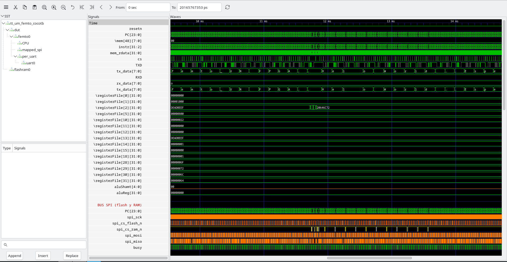
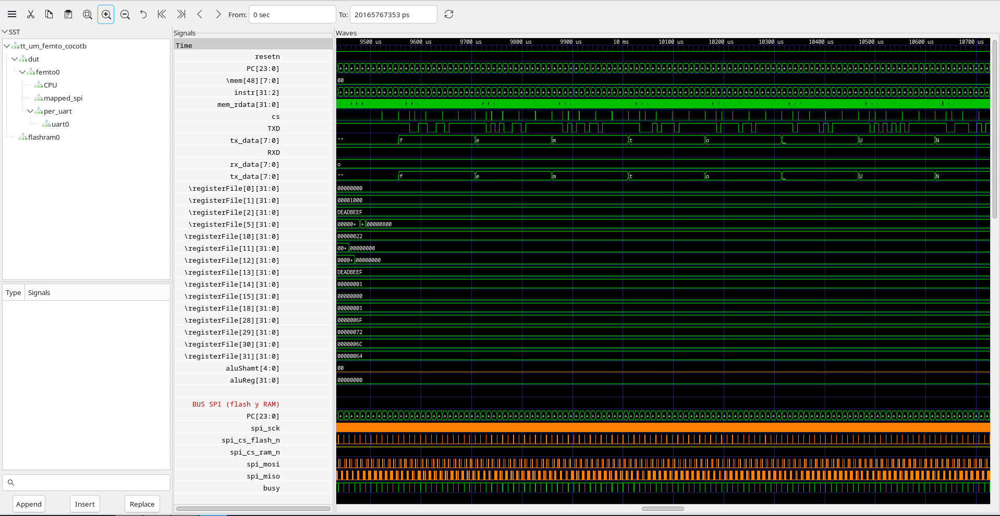

## Evidencias

**Programa de la prueba en FPGA (10–14 ms):** la UART envía `femto_UN FPGA`, `Hello World` y `Esperando IRQ...`. Por el mismo bus, `spi_cs_flash_n` está activo continuamente para leer instrucciones y `spi_cs_ram_n` se activa cerca de los 12 ms, cuando el programa escribe y lee la frase en la RAM. Los dos CS nunca coinciden.

**Detalle de la transmisión por la UART:** `tx_data` muestra cada carácter de `femto_UN` y `TXD` la trama serial correspondiente.

