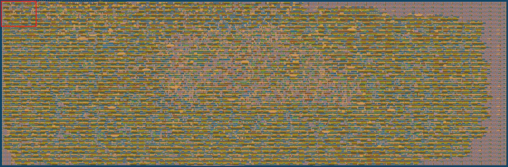
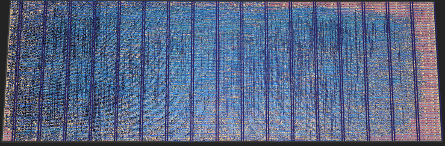
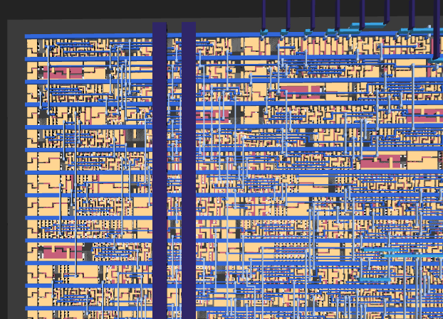
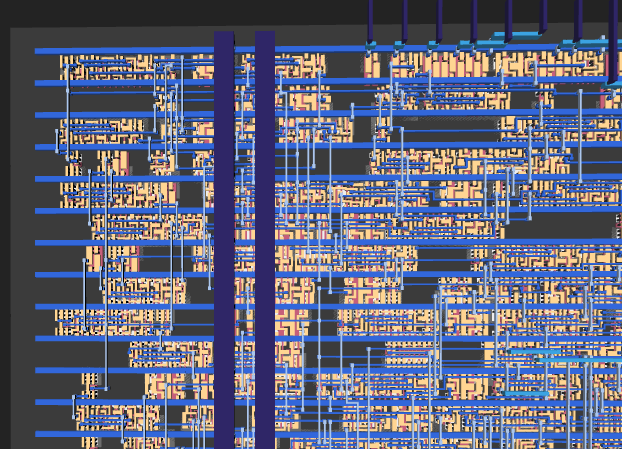
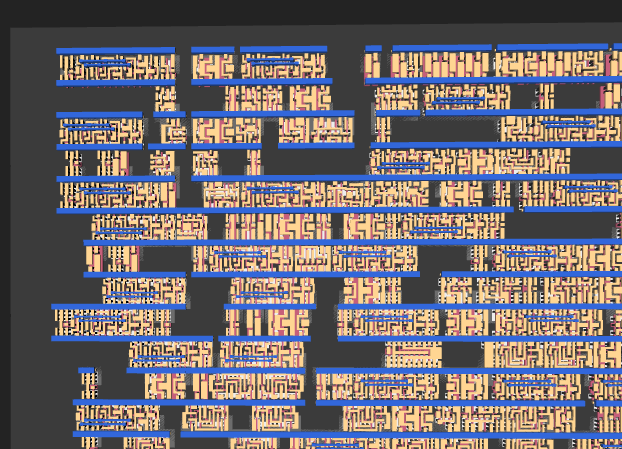
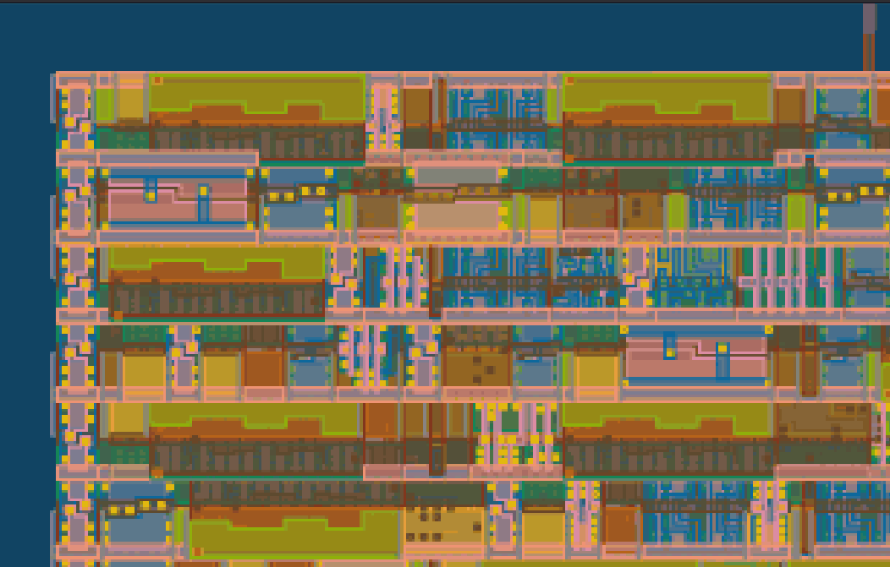
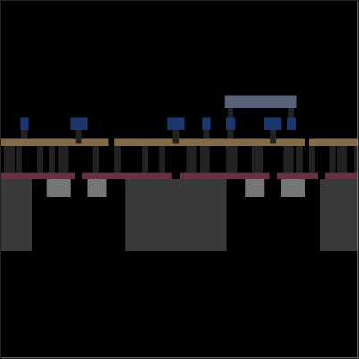
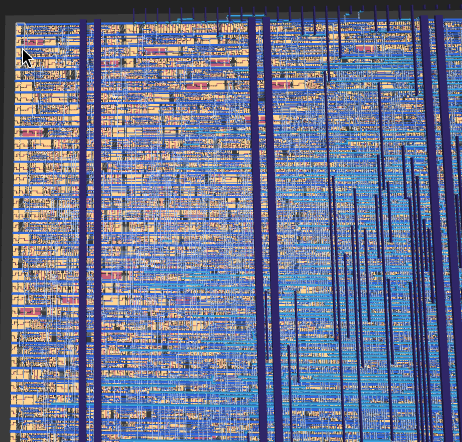

# Diseño fabricado: femto_UN en Tiny Tapeout (TTSKY25b)

## Introducción

El microcontrolador **femto_UN** ("UNAL's RISCV") es una implementación del núcleo RISC-V **femtoRV32 Quark** (RV32I) de Bruno Levy, desarrollada por el profesor Carlos Iván Camargo Bareño en la Universidad Nacional de Colombia. El diseño ejecuta el programa desde una memoria **flash SPI** externa, usa una **RAM SPI** externa como memoria de datos y se comunica por **UART** para la depuración.

El diseño se envió a fabricación en el shuttle **TTSKY25b** de Tiny Tapeout, sobre el proceso **SkyWater 130 nm** (PDK `sky130A`). Este shuttle cerró el 10 de noviembre de 2025 con 316 diseños y se envió a la fundición (ChipFoundry) ese mismo mes. El flujo físico (síntesis, colocación, ruteo y verificación) lo ejecutó automáticamente la GitHub Action de Tiny Tapeout con **LibreLane 2.4.2**, a partir del commit `baab83f` del repositorio [cicamargoba/femto_UN](https://github.com/cicamargoba/femto_UN).

Este documento presenta el layout final del chip, obtenido del repositorio oficial del shuttle, mediante vistas 2D y 3D, junto con los resultados de implementación reportados por el flujo.

## Datos del diseño

| Dato | Valor |
|---|---|
| Proyecto | UNAL's RISCV (`tt_um_femto`) |
| Shuttle | TTSKY25b (Tiny Tapeout) |
| Proceso / PDK | SkyWater 130 nm, `sky130A` (open_pdks `0fe599b`) |
| Librería de celdas | `sky130_fd_sc_hd` |
| Flujo | LibreLane 2.4.2 |
| Commit fabricado | [`baab83f`](https://github.com/cicamargoba/femto_UN/commit/baab83f5b7fe16083744b88fc54fe699873517e1) (5 nov 2025) |
| Tamaño | 4×2 tiles: **682,64 × 225,76 µm** (154 113 µm²) |
| Restricción de reloj | 25 ns (40 MHz) |
| Layout oficial | [`projects/tt_um_femto/tt_um_femto.oas`](https://github.com/TinyTapeout/tinytapeout-sky-25b/tree/main/projects/tt_um_femto) |

## Vista general

**Figura 1.** Render 2D del layout completo generado por Tiny Tapeout. El recuadro rojo marca, de forma aproximada, la zona ampliada en la Figura 3. Los pines del proyecto se conectan por el borde superior.

**Figura 2.** Vista 3D del layout completo en el visor de Tiny Tapeout. Las bandas verticales oscuras corresponden al power grid en metal 4.

## Ampliación de la esquina superior izquierda

**Figura 3.** La misma zona vista con distintas capas. En la librería `sky130_fd_sc_hd` cada fila de celdas mide 2,72 µm de alto, por lo que la zona mostrada tiene cerca de 33 µm de alto.

| (a) Todas las capas | (b) Sin celdas de relleno ni de desacople |
|---|---|
|  |  |
| **(c) Solo celdas estándar** | **(d) Render 2D** |
|  |  |

- **(a)** Las franjas azules horizontales son los rieles de alimentación (VPWR/VGND) en metal 1, uno por fila de celdas. Las dos bandas verticales moradas pertenecen al power grid en metal 4, y las líneas verticales delgadas son el ruteo de señales. Arriba se observan las conexiones de los pines.
- **(b)** Al ocultar las celdas de relleno (*fill*) y de desacople (*decap*) aparecen huecos: esa área no contiene lógica. La densidad de colocación objetivo fue del 70 %.
- **(c)** Sin el ruteo ni el power grid quedan solo las celdas estándar alineadas en filas. Las franjas azules que permanecen son los rieles propios de cada celda.
- **(d)** Vista plana con los colores de capa de sky130. En el borde izquierdo se observa la columna de celdas de borde de fila; las celdas más anchas corresponden a elementos secuenciales (flip-flops).

## Corte lateral y vista oblicua

| **Figura 4.** Corte lateral de una sección aislada | **Figura 5.** Vista oblicua del diseño completo |
|---|---|
|  |  |

La Figura 4 muestra el apilamiento vertical de capas: en la parte inferior las regiones de difusión y pozos, luego el polisilicio, los contactos, la capa de interconexión local (li1) y, encima, los metales. La Figura 5 muestra el diseño completo en perspectiva, donde se distinguen el power grid vertical y la densidad de ruteo.

## Resultados de implementación

Valores tomados de `stats/metrics.csv` del repositorio del shuttle.

| Métrica | Valor |
|---|---|
| Utilización del área | 76,0 % |
| Área de celdas estándar | 113 440 µm² |
| Celdas secuenciales (flip-flops) | 1 515 |
| Celdas combinacionales de varias entradas | 5 758 |
| Buffers e inversores del árbol de reloj | 80 + 1 296 |
| Buffers de reparación de tiempos | 2 259 |
| Celdas de relleno / tap | 7 159 / 2 158 |
| Diodos de antena insertados | 122 |
| Errores de DRC de ruteo (final) | 0 (tras 7 iteraciones) |
| Holgura de setup, esquina típica (tt, 25 °C, 1,80 V) | +3,50 ns |
| Holgura de hold, esquina típica | +0,31 ns |
| Holgura de setup, esquina lenta (ss, 100 °C, 1,60 V) | −4,85 ns (peor caso) |
| Potencia estimada, esquina típica | 6,58 mW |

**Verificaciones previas al envío (precheck de Tiny Tapeout):** Magic DRC, KLayout FEOL/BEOL, *offgrid*, pines, límites, alimentación, capas, nombres de celdas y *urpm/nwell* aprobados. El reporte completo está en `vlsi/femto_UN/test/238_tt_um_femto_UN/19103989012_gds/precheck_reports/`.

## Observaciones

- Con la restricción de 25 ns el diseño cumple tiempos en las esquinas típica y rápida, pero no en la lenta (ss, 100 °C): en el peor caso requeriría un periodo cercano a 30 ns (unos 33 MHz).
- LibreLane reporta 20 redes con violaciones de antena después de insertar los diodos; el precheck de Tiny Tapeout no las marcó como bloqueantes.
- La carpeta `tinytapeout_femto_UN/` de este repositorio corresponde al commit `b28ff83`, posterior a la fabricación. Respecto al commit fabricado (`baab83f`) solo difiere `src/MappedSPIFlash.v`.

## Fuentes

- Repositorio del diseño: <https://github.com/cicamargoba/femto_UN>
- Layout oficial del shuttle: <https://github.com/TinyTapeout/tinytapeout-sky-25b/tree/main/projects/tt_um_femto>
- Página del shuttle TTSKY25b: <https://tinytapeout.com/chips/ttsky25b/>
- Envío del shuttle a fabricación: <https://tinytapeout.com/news/ttsky25b-submitted/>
- Ejecución del flujo GDS: <https://github.com/cicamargoba/femto_UN/actions/runs/19103989012>
