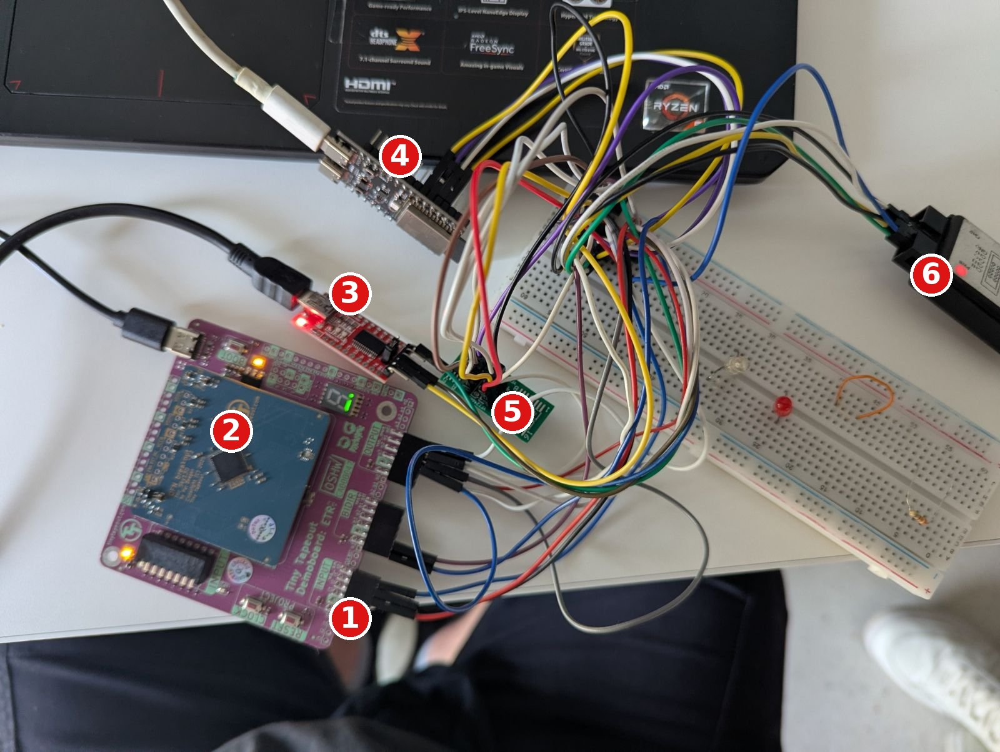
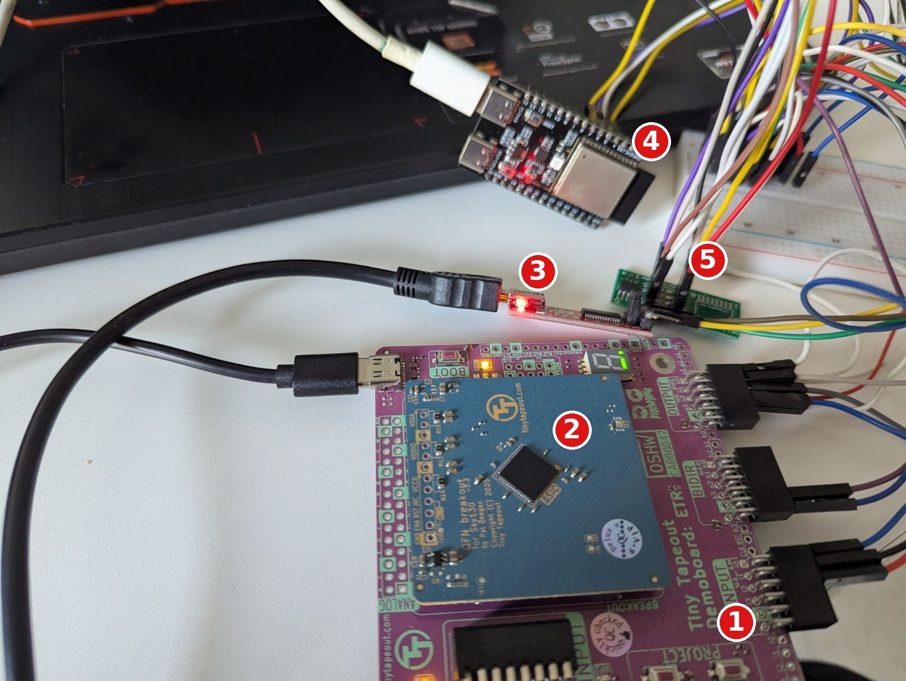

# Pruebas del chip femto_UN fabricado

Evidencias de las pruebas realizadas al chip femto_UN en la placa de demostración de Tiny Tapeout: fotos del montaje, capturas del analizador lógico y de las terminales, y las sesiones originales de PulseView. La descripción completa de cada prueba está en el informe técnico del proyecto.

Condiciones comunes a todas las pruebas:

- Reloj del procesador en **100 kHz**, configurado desde la consola de la placa de demostración (`mpremote`).
- Memoria de programa: **ESP32-C6** como flash SPI emulada.
- Memoria RAM: **FM25V02** (F-RAM SPI de 32 KB).
- UART a **481 baudios**, leída con un adaptador FTDI y `minicom`.

## Contenido

```
pruebas_chip/
├── fotos/                  Montaje físico
├── capturas/
│   ├── arranque_flash/     Primer arranque y Hello World
│   └── ram/                Prueba de la RAM y programa de mayúsculas
└── pulseview/              Sesiones originales del analizador (.sr)
```

## Montaje

| Montaje completo | Detalle |
|---|---|
|  |  |

(1) placa de demostración de Tiny Tapeout; (2) chip femto_UN sobre la placa adaptadora QFN; (3) adaptador USB-UART FTDI; (4) ESP32-C6, memoria flash emulada; (5) FM25V02 en su adaptador SOIC; (6) analizador lógico. Las fotos sin numerar están en la misma carpeta.

### Conexiones

| Interfaz | Señal | Pin del chip | Destino |
|---|---|---|---|
| Flash (ESP32-C6) | CS | `uo[2]` | GPIO7 |
| | CLK | `uo[5]` | GPIO6 |
| | MOSI | `uo[0]` | GPIO5 |
| | MISO | `ui[0]` | GPIO4 |
| RAM (FM25V02) | CS | `uo[3]` | CS |
| | CLK | `uo[4]` | SCK |
| | MOSI | `uo[1]` | SI |
| | MISO | `ui[1]` | SO |
| UART (FTDI) | TXD | `uo[7]` | RXD |
| | RXD | `ui[2]` | TXD |

## Prueba 1: arranque con la flash emulada y Hello World

| Archivo | Qué muestra |
|---|---|
| `flash_fase2_zoom.png` | Lectura en fase 2: la selección conmuta junto con un pulso del reloj y el comando llega como `06` |
| `flash_fase2_189ms.png` | 64 flancos (1,89 ms) entre dos pulsos de la selección |
| `flash_arranque.png` | Arranque: dos lecturas ignoradas (`06 …`) y reinicio con `03 00 00 00` → `1B 81 A0 00` |
| `hello_minicom.png` | `Hello World from femto UN` en `minicom` y configuración desde `mpremote` |
| `hello_pulseview.png` | Mensaje decodificado en la línea TX junto con el bus de la flash |
| `hello_pulseview_uart.png` | Decodificación de la UART con el mensaje completo |

## Prueba 2: lectura, escritura y persistencia en la RAM

| Archivo | Qué muestra |
|---|---|
| `ram_contador.png` | Ejecuciones sucesivas: el contador E1 sube en cada reinicio; E2 (sin WREN) no cambia |
| `ram_desconexion.png` | Tras perder la conexión con la placa, el contador continúa desde el valor guardado |
| `ram1_l1.png`, `ram1_l2.png` | Lecturas de `0x0000` y `0x1000` |
| `ram1_e1_lectura.png` | Lectura del contador E1 (`01`) |
| `ram1_e1_secuencia.png` | Lectura en fase mala (WREN), escritura del valor 2 y relectura |
| `ram1_e2_lectura.png`, `ram1_e2_escritura.png` | Control E2: escritura sin WREN rechazada, el valor sigue en `…CB` |

## Prueba 3: conversión de texto a mayúsculas

| Archivo | Qué muestra |
|---|---|
| `ram_mayus_terminal.png` | Sesión del programa: texto enviado y respuesta en mayúsculas |
| `ram_mayus_pulseview.png` | Actividad del bus de la RAM durante la conversión |

## Sesiones de PulseView

Se abren con PulseView (*File → Open*). Todas se tomaron a 1 MHz.

| Archivo | Duración | Canales | Contenido |
|---|---|---|---|
| `ESP_32_FLASH_TX.sr` | 2 s | D0 MISO, D1 MOSI, D2 CLK, D3 CS, D4 TX | Bus de la flash y UART durante el Hello World |
| `RAM_1.sr` | 10 s | D0 CS, D1 MISO, D2 MOSI, D3 CLK | Bus de la RAM durante `ram_test.S` |
| `RAM_HOLA.sr` | 6 s | D0 CS, D1 MISO, D2 MOSI, D3 CLK | Bus de la RAM al escribir `hola` con el programa de mayúsculas |

Para decodificar, se agrega el decodificador SPI (modo 0, CS activo en bajo) y, en `ESP_32_FLASH_TX.sr`, el decodificador UART a 481 baudios sobre TX.
