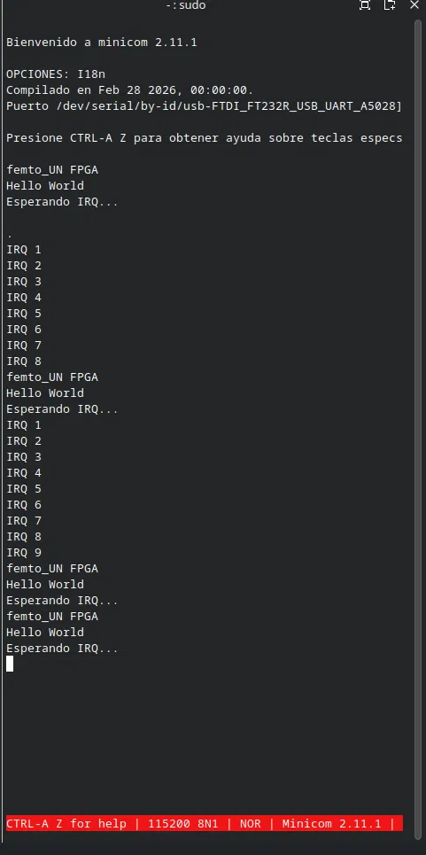

# Prueba en FPGA del femto_UN v2 (Tang Primer 20K)

Prueba en hardware del procesador mejorado, con bus SPI único e interrupciones, implementado en una FPGA Sipeed Tang Primer 20K Dock. Las memorias son externas: un ESP32-C6 emula la flash y la RAM es una FM25V02. La UART se lee con un adaptador FTDI.

- **Diseño y fuentes:** [`disenos/vlsi/femto_UN/fpga/`](../../disenos/vlsi/femto_UN/fpga/), donde están el top, los pines, los scripts de Gowin, el emulador de flash y la tabla completa de conexiones.
- **Simulación previa del mismo programa:** prueba `test_programa_fpga` en [`disenos/vlsi/tinytapeout/`](../../disenos/vlsi/tinytapeout/README_cocotb.md).

## Montaje

| Elemento | Función |
|---|---|
| Tang Primer 20K Dock (GW2A-LV18PG256C8/I7) | Procesador femto_UN v2, PLL de 27 a 24 MHz |
| ESP32-C6 | Emula la flash SPI con el programa de prueba |
| FM25V02 | RAM SPI (32 KB, dirección de 2 bytes) |
| Adaptador FTDI FT232R | UART a 115200 baudios |

Todo el bus SPI va por el PMOD0 del Dock. SCK, MOSI y MISO son comunes a las dos memorias; cada una tiene su propio CS.

| Señal | Pin FPGA |
|---|---|
| SCK | T7 |
| MOSI | T8 |
| MISO | P9 |
| CS flash | P8 |
| CS RAM | T6 |
| UART TX / RX | P6 / R8 |

- **Botones:** S0 = reset, S1 = IRQ con antirrebote.
- **LEDs:** L14 = LED del femto, L16 = latido, N14 = actividad de la RAM, N16 = actividad de la flash.
- **Bus:** 30 kHz (`SPI_DIV = 400`) con `SPI_CS_WAIT = 6`.

## Procedimiento

1. Generar el programa con la simulación (`make cocotb` en `disenos/vlsi/tinytapeout`), que deja `build/cocotb/programa_fpga.bin`, y convertirlo en `firmware.h` con `bin2h.py`.
2. Cargar el emulador de flash en el ESP32-C6 (`esp32_flash_emu/`).
3. Generar y cargar el bitstream desde `disenos/vlsi/femto_UN/fpga/` con `make bitstream` y `make prog`.
4. Abrir la UART con `minicom -b 115200 -D /dev/ttyUSB0`.
5. Presionar S0 para reiniciar y S1 para generar interrupciones.

## Resultado

Al arrancar, el procesador lee el programa de la flash emulada, escribe la frase en la RAM y la vuelve a leer para enviarla por la UART. Cada pulsación de S1 genera una sola interrupción, que imprime `IRQ n`:

    femto_UN FPGA
    Hello World
    Esperando IRQ...
    IRQ 1
    IRQ 2
    ...

Esto confirma en hardware que:
- la lectura de la flash por el bus único funciona (el programa arranca y corre);
- la escritura y lectura de la RAM funcionan (`Hello World` se envía después de leerlo de la RAM);
- la interrupción se atiende por flanco: una pulsación da una sola línea.

## Problemas encontrados y solución

| Problema | Causa | Solución |
|---|---|---|
| Cada letra se repetía unas 25 veces | `tx_wr` era un nivel y, con el bus lento, quedaba activo varios ciclos | `tx_wr` y `rx_ack` pasaron a ser pulsos de un ciclo (`perip_uart.v`) |
| Varios reinicios con una sola pulsación de S0 | Rebote del botón | El reset termina unos 22 ms después de soltar el botón |
| El ESP32 respondía datos corridos y se disparaba su watchdog | El CS quedaba solo 83 ns en alto entre tramas | Estado `DONE` en `MappedSPIBus.v` y espera `SPI_CS_WAIT` antes y después de cada trama |
| Lecturas erróneas del ESP32 | Emulación por software sensible a interrupciones y ruido | En el sketch: MISO en alta impedancia con CS alto, lecturas filtradas (3 valores iguales), interrupciones desactivadas durante cada transacción y contador de errores (comando `p`) |
| El FTDI no aparecía como `/dev/ttyUSB0` | Faltaba el driver en Fedora | `sudo modprobe ftdi_sio` (paquete `kernel-modules-extra`) |

## Limitaciones y observaciones abiertas

- **Reinicios esporádicos:** como se ve en la captura, después de varias interrupciones el saludo `femto_UN FPGA` vuelve a aparecer sin haber presionado S0. En simulación, 12 interrupciones seguidas no producen reinicios, así que la causa probable está en el montaje o en el emulador de flash. Queda pendiente revisar el contador de errores del ESP32 (comando `p`) cuando ocurra.
- El chip fabricado y la placa tester mantienen la arquitectura de dos buses; esta prueba corresponde a la siguiente versión del procesador.

## Pendiente

- [ ] `fotos/`: fotos del montaje (Tang, ESP32-C6, FM25V02 y FTDI).
- [ ] `pulseview/`: capturas y sesión de PulseView del bus SPI durante la prueba.
